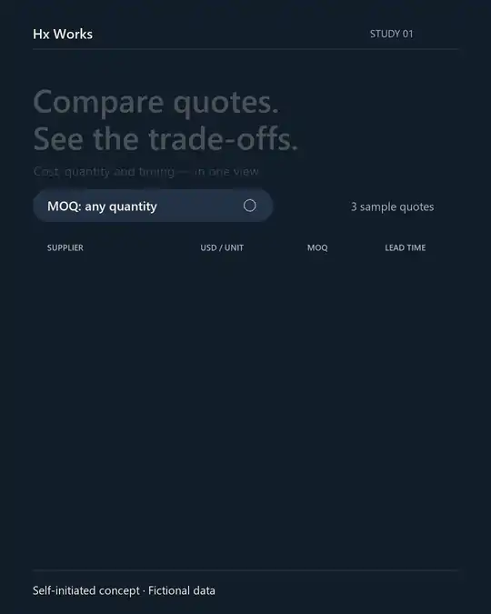

# Quote comparison — motion study

**Hx Works · Self-initiated concept · Fictional data**

A silent, 12-second UI animation exploring the trade-offs between unit price, minimum order quantity and lead time. Three fictional supplier cards enter in sequence, a single MOQ filter narrows the comparison, and the final state holds for reading.

[Watch or download the full MP4](hx-works-quote-comparison-motion-study.mp4) · [Offline player source — download before use](index.html)



The MP4 is 1080 × 1350 at 30 fps. This inline preview is 540 × 675 at 15 fps and loops. All names and figures are fictional. This is a code-authored concept, not a client campaign or a claim of sales, CTR or other campaign results.

## Source and rebuild

The included `render_ui_motion_study_20261016.py` is the unchanged source used to render the full MP4. With an existing Python 3.11+ installation, Pillow, ffmpeg with the `libx264` encoder, and Windows Segoe UI fonts, run from this folder:

```powershell
python render_ui_motion_study_20261016.py --output-dir .
```

The explicit output folder makes the copied source portable. The renderer emits the MP4, preview frames and local checks; it does not download dependencies or contact a service. It overwrites its named outputs when deliberately rerun. Exact pixels and encoding depend on the installed font and tool versions.

`poster.png` is an actual frame extracted at 11.2 seconds. The animated WebP was derived from the full MP4. No fonts, ffmpeg executable, customer assets or third-party brand materials are included. Fonts are rendered into pixels only. This package does not add a new licence grant.
