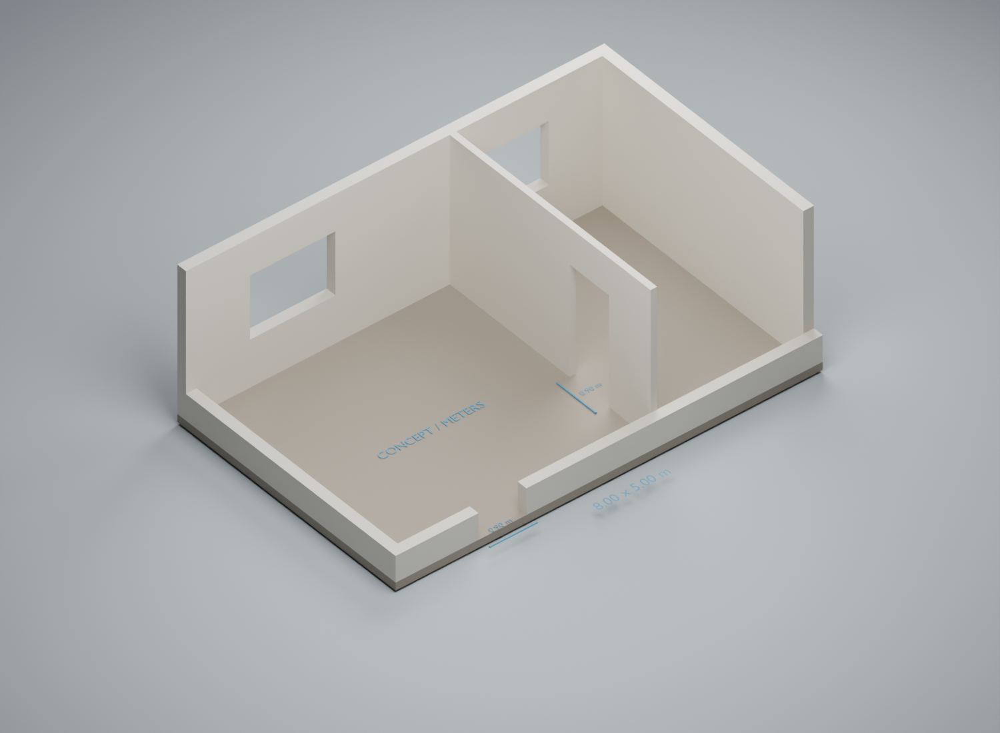

# Architectural openings — self-initiated geometry study

Hx Works · fictional 8.00 × 5.00 m conceptual layout · 19 October 2026

This is an original capability study, not a client project, surveyed property, construction document or built-work claim. The geometry was authored with an AI-assisted Python/bpy workflow and rendered in Blender 5.2.1 LTS. No customer drawing, photograph or model was used.

## Inspect the geometry

- [Editable Blender scene](editable-room-study.blend): open `01 Editable model - meters` for the full-height model. `02 Presentation cutaway only` contains the display proxies and notation.
- [GLB model](editable-room-study.glb): full-height walls, openings and slab; presentation geometry excluded.
- [Dimensions and assumptions](plan-specification.json)
- [Build source](build.py) and [fresh-import verifier](verify_export.py)

The model uses meters, 2.80 m walls, 0.20 m external wall thickness and a 0.12 m partition. Both door clear widths are 0.90 m, with 2.10 m heads. Windows have 0.90 m sills and 2.10 m heads. The front and left walls are cut down only in the illustration so the interior can be inspected; the source geometry and GLB retain the full heights.

## Modeling decision and checks

Wall elements are separate, named closed cuboids. Segmenting around openings keeps lintels, sills and clearances explicit and editable, without hidden Boolean cutters. This is not a claim of one continuous welded building mesh.

The [14 actual-polygon ray checks](geometry-checks.json) test clear space just inside each door jamb and head, solid wall just outside, and the north-window vertical limits. All 14 passed. These checks examine the constructed geometry, rather than trusting dimension labels alone.

A fresh process imported the GLB as 16 meshes. Its overall world bounds matched the expected 8.00 × 5.00 × 2.95 m wall-and-slab envelope with a maximum error below 0.000001 m; see [reimport results](reimport-checks.json). This verifies basic export scale, not every geometric property or a target application.

## Limits

No building-code, structural, BIM/MEP, photoreal interior, surveyed accuracy or production architecture experience is claimed. A real assignment needs permitted references, agreed authoritative dimensions and unresolved assumptions, target file requirements, acceptance criteria, fees and payment terms before work begins.
