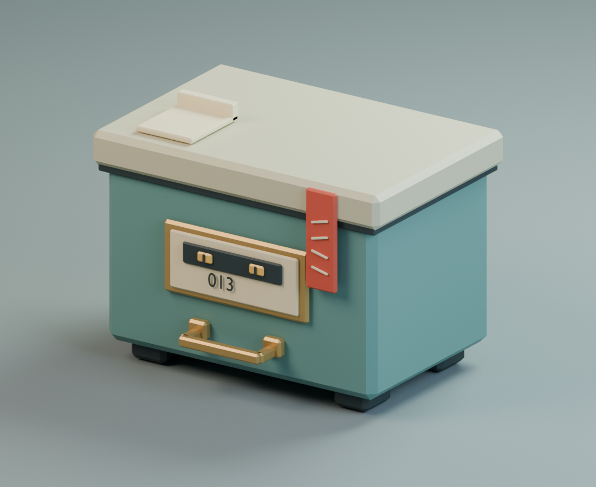

# Misfiled Archive Box — stylized prop study

**Hx Works · Self-initiated · Original geometry · AI-assisted Blender scripting**



An institutional archive box with an odd pair of eyes behind its label and an unlettered red paper seal. The marks are abstract, not claimed Chinese writing. This is a personal style/capability study, not a client asset or a shipped game prop.

[Inspect the editable GLB model](archive-box.glb) · [Build source](build.py) · [Native re-import check](glb-import-check.json)

## Recorded result

Blender 5.2.1 LTS exported 29 separate mesh objects, 2,212 triangles and seven material assignments. A fresh isolated Blender process imported the exported GLB and confirmed those counts, finite vertex coordinates, and no camera or light in the asset. There are no image textures or external asset dependencies. The PNG is an actual render of this model; its path metadata was removed by disabling Blender stamp metadata and rendering again, with identical decoded pixels.

## Limits

The model is a closed stylized box, not a hollow or functioning hinged container. Components intersect; it is not a watertight print model. Dimensions are illustrative, not a client's agreed scale. Unity import, gameplay, UV texture painting, LOD, collisions, rigging and production performance were not tested. Neither client acceptance, commercial experience nor exclusive rights are claimed. A real commission needs agreed scope, engine/export requirements, rights, allowed tools, acceptance checks, revisions, price and payment.

## Rebuild in an isolated process

With an existing Blender 5.2.1 installation, run from this folder:

```sh
blender --background --factory-startup --python build.py
blender --background --factory-startup --python verify.py
```

The build clears its active scene and writes named GLB, blend, PNG and JSON outputs into its own folder. Use a new background process, not an existing working GUI scene. It performs no network requests or dependency installation. The verification imports the GLB in a fresh empty scene. Exact render timings may vary. The working blend file and private logs are not included. This demonstration adds no separate licence grant for production use; agree the applicable rights before a commission.
