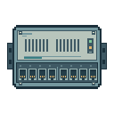

# 128 px network-switch study

A self-initiated, code-authored illustration of a fictional network switch. This is an independent capability study, not a client commission or a finished asset set. AI assisted the code workflow.

## Native size

## Enlarged view

## Files and checks

- Transparent 128 × 128 RGBA PNG; alpha values are only 0 and 255.
- Editable SVG with named groups and 114 integer-aligned rectangles; no embedded bitmap, font or external asset.
- Eleven opaque colours. Independently rendering the SVG produced the same pixels as the PNG.
- The native-size review covered the outline, ventilation slots, eight ports and indicators.

Cable joins, extra orientations, animation and engine integration are not demonstrated. A client's style, asset list, dimensions, revisions, usage rights and total fee would be agreed before commissioned work.
