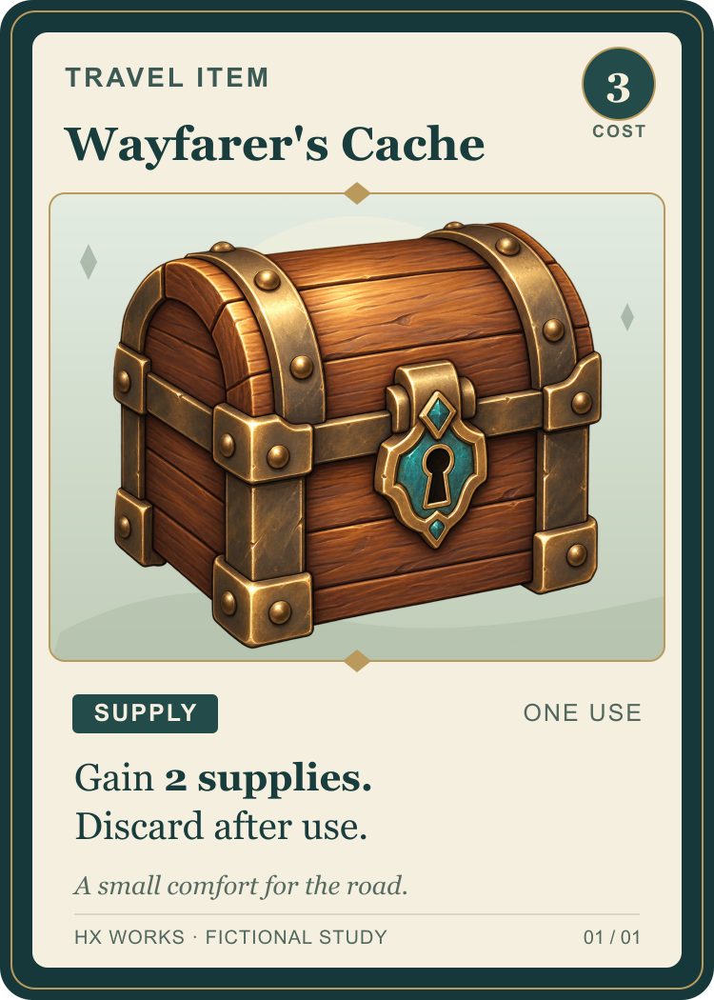

# Fantasy card layout study

One fictional card front by **Hx Works**, made to demonstrate information hierarchy around an existing illustration. This is a self-initiated study, independent of any client or published game.

[Editable SVG](wayfarer-cache.svg) · [PNG preview](wayfarer-cache.png)

## Layout and source

- A readable title, cost, category, use condition, effect and flavour line.
- Eleven editable SVG text elements, vector frame geometry, badges and ornaments.
- One embedded raster illustration; it remains raster artwork when the SVG is edited.
- A single self-contained SVG, with no external assets, scripts or customer material.

The chest illustration reuses our own AI-assisted raster study from 14 October 2026. Its bytes are unchanged: SHA-256 `e1636e63507abad82a5264f9c06bc965634d0599442b6d838069637f2eaf0ee1`. The vector layout and fictional card text were authored for this example. The illustration is not hand-painted or a layered source file; this demonstration makes no claim of exclusive rights in generated artwork.

## Checked

The SVG was rendered with Sharp 0.35.5 / librsvg 2.63.2 to a **750 × 1050 px sRGB PNG**. The rendered title, rules, cost, frame and illustration were visually inspected. The embedded illustration matches the original bytes, and the source retains actual text elements.

Fonts are referenced rather than bundled: Georgia and Arial, with generic serif/sans-serif fallbacks. Appearance can change with font substitution.

This example covers one card front. Card backs, a full icon system, player aids, score sheets, rulebook pages, automated data population and a publisher's print specifications require separate scope and checks. The fictional rules have not been playtested. Bleed, CMYK conversion, PDF/X and physical print proofs are outside this study.
