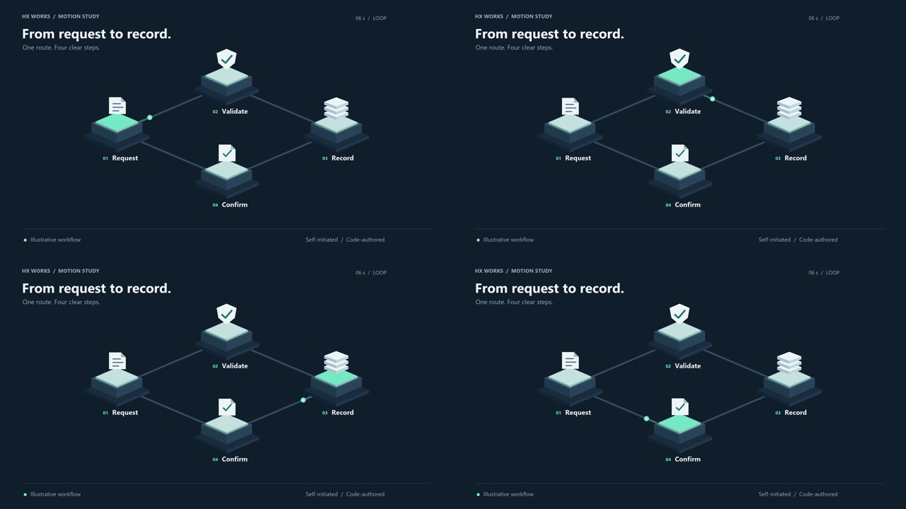

# Isometric workflow study

A six-second, self-initiated motion example by Hx Works. A packet travels through four illustrated steps: request, validate, record and confirm. The active step changes as the packet moves. This is an illustrative sequence, not a depiction of an implemented financial system.

- [Play/download the 1280 × 720 MP4](workflow-loop.mp4), six seconds at 30 fps, silent, H.264.
- [Editable SVG still](poster.svg): separate vector shapes and live text. Segoe UI is referenced, not embedded or redistributed; another installed font can change text metrics.
- [Animation source](render.py): original Python/Pillow geometry and animation. MP4 frames are raster exports; this is not an After Effects or Cinema 4D project.
- [Numerical checks](qa.json): frame count, exact six-second endpoint and output hashes. These are internal checks, not client acceptance or evidence of a full narrated explainer.

All shapes, composition and animation code were authored for this study with automated assistance. No client material, stock graphics, third-party artwork or confidential data is included. The work is a capability example, not paid client experience. It does not demonstrate voiceover, sound design, character animation or a complete production pipeline.

Rebuild with Python, Pillow and FFmpeg. The renderer expects Windows Segoe UI at the local font path; change that path for another environment. Do not redistribute font files.

Original code and original vector artwork in this folder are offered under the repository's existing license, if present; otherwise no additional reuse license is granted by this note. Third-party software and fonts retain their own terms.
