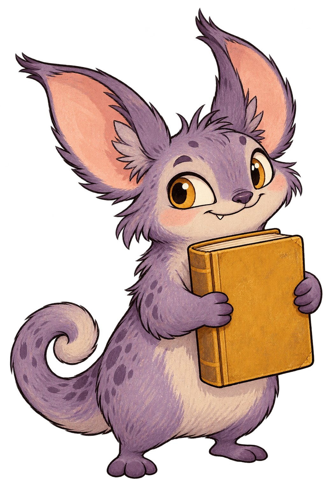

# Book Creature — illustration study

**Hx Works · Self-initiated style study · Fictional character**

One curious creature, a clear silhouette and a simple book prop. This study explores a friendly character direction for small illustrated cards. It is an independent capability example, with no affiliation with a library, publisher or client.

## Format and workflow

- One AI-assisted raster illustration; no client references or private materials were used.
- PNG, 1024 × 1536 pixels, with an alpha channel. This is a preview rather than a print-ready card: the final crop, edge treatment, background and output specifications would be checked against an agreed brief.
- No vector or layered source, tested thumbnail export, CMYK conversion, print proof or client approval is represented here.

## Discuss a specific illustration

A public style reference and the required output dimensions are enough for an initial discussion. The asset list, revisions, delivery date, price, permitted tools and usage rights would be agreed before work starts.

This publication grants no additional licence to reuse the image in a product. Rights for a commissioned asset would be agreed separately. This AI-assisted study makes no claim of exclusivity or independent infringement clearance.

