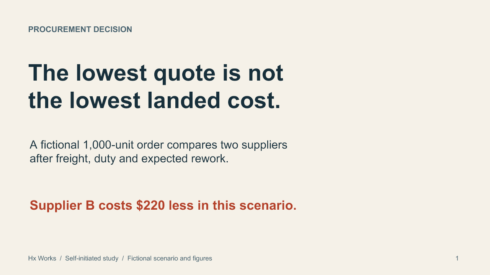
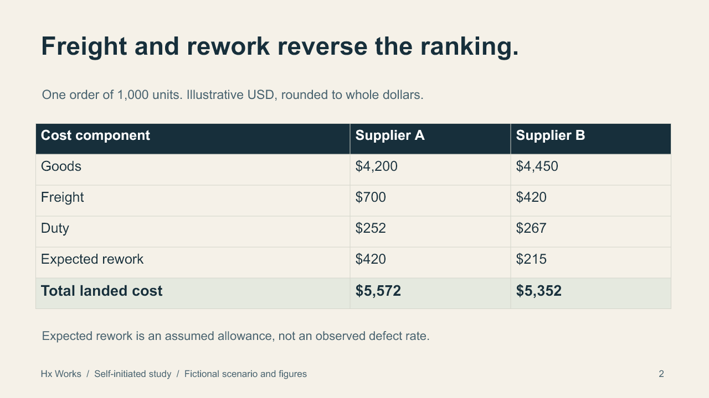
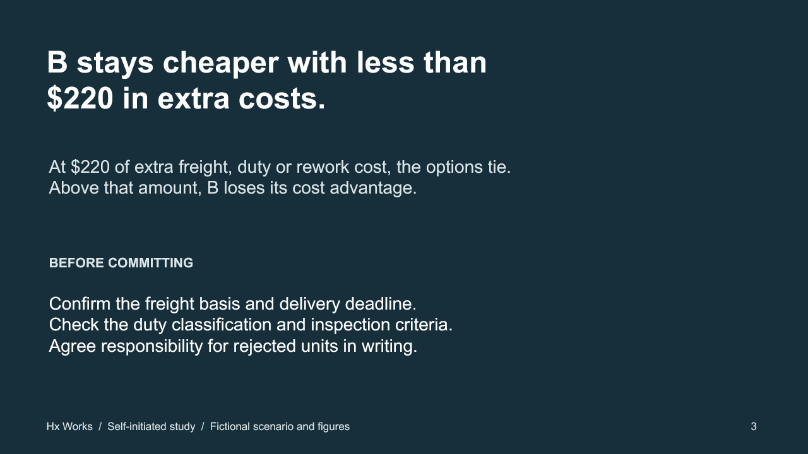

# Supplier decision: a three-slide presentation study

**Hx Works | Self-initiated portfolio exercise | October 2026**

This short business presentation turns a fictional supplier comparison into a conditional decision. It is an independent practice project, not client work or an actual sourcing result. All suppliers, quantities and costs are invented for the exercise.

The sequence introduces the decision, shows the cost build-up, then states the point at which the recommendation changes. The second slide contains an editable PowerPoint table, with component costs summing to each displayed total. Text remains editable throughout.

[Download the editable PowerPoint](supplier-decision-study.pptx)

## 1. Decision

## 2. Evidence

## 3. Conditions

## Scope and workflow

The deck uses code-based authoring and AI-assisted writing/design iteration. Checks covered the three-slide package, editable table, arithmetic, import by the authoring library and individual rendered previews. Desktop PowerPoint and arbitrary downstream conversions have not been tested for this deck.

There are no customer assets, real supplier claims, measured business outcomes or confidential inputs. The visual direction belongs to this exercise and is not a universal style preset. It does not demonstrate a complete fundraising strategy or an actual enterprise QBR/EBR engagement.
